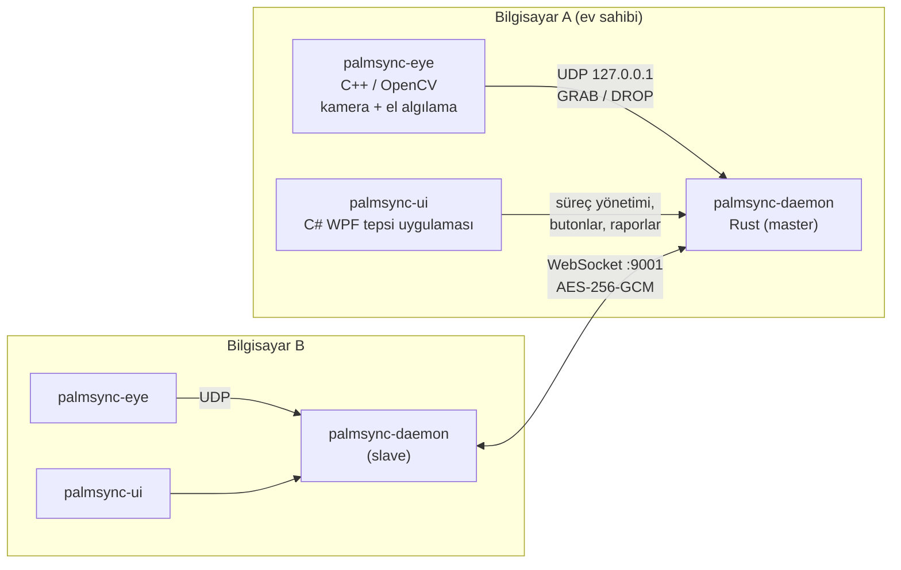

# 🖐 PalmSync

**El hareketiyle bilgisayarlar arası çalışma alanı aktarımı — bulutsuz, uçtan uca şifreli.**

[](https://github.com/SerdarK44/PalmSync-Gesture-Based-Context-Transfer-Between-Devices/releases/latest)


Bir bilgisayarda kameraya açık elini gösterip **yumruk yaparsın** — o an açık olan
VS Code dosyası (içeriğiyle birlikte), tarayıcı sekmesi ve pano **yakalanır**.
Diğer bilgisayarda **yumruğunu açarsın** — hepsi orada kaldığın yerden açılır.
Sunucu yok, bulut yok: iki bilgisayar aynı ağda doğrudan konuşur.

---

## ✨ Özellikler

- **El hareketi algılama** — model indirmeden, klasik görüntü işlemeyle:
  ten rengi bölütleme + avuç dairesi / parmak halkası yöntemi + dışbükey kusurlar.
  Yüz algılanıp maskelenir, takip **sadece ele kilitlenir** ("EL" etiketi),
  hareketler kasıtlı geçişlerle tetiklenir (açık → yumruk = *Yakala*,
  yumruk → açık = *Geri yükle*).
- **Gerçek içerik aktarımı** — dosyanın sadece adı değil içeriği gider; karşı
  bilgisayarda aynı dosya varsa o açılır, yoksa `Belgeler\PalmSync\Gelen Dosyalar`
  altına yazılır. Mevcut dosyaların üzerine asla yazılmaz.
- **Güvenli P2P** — WebSocket üzerinden nonce tabanlı challenge-response el
  sıkışması, sonrasında tüm trafik **AES-256-GCM** ile şifreli; hız sınırlama,
  girdi doğrulama, güvenlik denetim kaydı.
- **Tek ekranda kullanım** — "Oturum başlat" bir kod + şifre üretir, diğer
  bilgisayar "Oturuma katıl" ile bağlanır. IP, port, rol yok.
- **Sistem kontrolü 🔧** — eksik dosya/DLL, engellenen exe, kamera izni, kamerayı
  başka uygulamanın kullanması, güvenlik duvarı, sertifika… 19 kontrol;
  düzeltilebilenleri tek tıkla (yönetici gerekenleri tek UAC onayıyla) düzeltir.
- **Merkezi hata raporu** — katılan bilgisayarların sorunları otomatik olarak ev
  sahibi bilgisayarın `cihaz-raporlari.log` dosyasına gelir.
- **Düzenli loglar** — `Belgeler\PalmSync\Loglar`; canlı, filtrelenebilir log
  görüntüleyici ve tek tıkla `.zip` dışa aktarma.
- **Otomatik güncelleme** — uygulama GitHub Releases'i denetler, yeni sürümü
  doğrulayıp (SHA-256 + imza) kurar.

## 📥 Kurulum

1. [Releases](https://github.com/SerdarK44/PalmSync-Gesture-Based-Context-Transfer-Between-Devices/releases/latest)
   sayfasından **`PalmSync-Setup-x.y.z.exe`** dosyasını indir ve çalıştır
   (gerekirse .NET 8 Desktop Runtime'ı da kendisi kurar).
2. İlk açılışta **Sistem kontrolü** penceresi gelir → **🔧 Hepsini düzelt**.
3. İki bilgisayarda da kur; aynı Wi-Fi / ağda olmaları yeterli.

> Kurulum dosyası kendinden imzalı bir sertifikayla imzalıdır. Windows
> SmartScreen uyarırsa *Ek bilgi → Yine de çalıştır*. **Akıllı Uygulama
> Denetimi** açık bilgisayarlarda kapatılması gerekebilir (bkz. [SETUP.md](SETUP.md)).

Sonraki sürümler uygulama içinden gelir: ana pencerede **"⬆ Güncelleme var —
Şimdi yükle"** çıkar (ya da *Ayarlar → Hakkında*'dan otomatik kurulumu aç).

## 🚀 Kullanım

| Adım | Bilgisayar A (ev sahibi) | Bilgisayar B |
|---|---|---|
| 1 | **Oturum başlat** → kod + şifre görünür | **Oturuma katıl** → kodu ve şifreyi gir |
| 2 | VS Code'da dosyanı / tarayıcıda sekmeni öne al | |
| 3 | ✊ **Yakala** (buton ya da açık el → yumruk) | |
| 4 | | 🖐 **Geri yükle** (buton ya da yumruk → açık el) |

El hareketleri için: elini parmaklar ayrık şekilde göster, yeşil **EL** etiketi
çıkınca yumruk yap. Elini yüzünün önüne değil yanına getir. Ayrıntılar ve sorun
giderme: **[SETUP.md](SETUP.md)**.

## 🏗 Mimari



| Bileşen | Dil | Görev |
|---|---|---|
| [`brain/`](brain) | Rust | Arka plan servisi: bağlam yakalama (VS Code, tarayıcı, pano), geri yükleme, oturum yönetimi, loglar |
| [`networking/`](networking) | Rust | Master/slave WebSocket katmanı, el sıkışma, şifreleme, hız sınırlama |
| [`shared/`](shared) | Rust | Mesajlar, yapılandırma, kripto, doğrulama, denetim kaydı |
| [`eye/`](eye) | C++17 / OpenCV | Kamera, yüz maskeleme, el kilidi, açıklık ölçümü, hareket durum makinesi |
| [`ui/`](ui) | C# / WPF (.NET 8) | Tepsi uygulaması, ana pencere, log görüntüleyici, sistem kontrolü, güncelleyici |
| [`installer/`](installer) | Inno Setup | Kurulum, imzalama, sertifika ve güvenlik duvarı ayarı |

## 🛠 Kaynaktan derleme

Gereksinimler (Windows 10/11 x64):

- Rust (stable) — `cargo`
- Visual Studio 2026 (C++ masaüstü iş yükü, CMake dahil)
- vcpkg + OpenCV:
  `vcpkg install "opencv4[dnn,highgui,msmf,dshow,jpeg,png,tiff,webp]:x64-windows"`
- .NET 8 SDK
- Inno Setup 6 (sadece kurulum dosyası için)

```powershell
.\build.ps1                    # daemon + eye + ui  ->  build\
.\build.ps1 -Installer -Sign   # + imzalı dist\PalmSync-Setup-<sürüm>.exe
cargo test --workspace         # Rust testleri
eye\build.ps1                  # C++ derleme + el hareketi testleri
```

Sürüm numarası kök dizindeki [`VERSION`](VERSION) dosyasından gelir.

### Yeni sürüm yayınlama

```powershell
.\release.ps1                  # 0.2.0 -> 0.2.1
.\release.ps1 -Version 0.3.0
```

Betik derler, imzalar, etiketi GitHub'a gönderir ve Release'i kurulum dosyası +
SHA-256 özetiyle oluşturur; kurulu uygulamalar yeni sürümü kendileri bulur.

## ✅ Testler

100'ü aşkın otomatik test: kripto, el sıkışma ve tekrar saldırısı, gerçek
WebSocket üzerinde master/slave entegrasyonu, güvenlik, düzeltilen hataların
regresyon testleri, log döndürme, el hareketi durum makinesi ve sentetik
görüntülerle el/yüz ayırt etme. Ayrıntılar: [TESTING.md](TESTING.md).

## 📚 Belgeler

- [SETUP.md](SETUP.md) — kurulum, kullanım, el hareketleri, güncellemeler, loglar, sorun giderme
- [TESTING.md](TESTING.md) — test takımları ve komutlar
- [SECURITY.md](SECURITY.md) — güvenlik modeli
- [KNOWN_ISSUES.md](KNOWN_ISSUES.md) — bilinen sınırlamalar ve düzeltilen hatalar
- [documents/](documents) — geliştirme fazları

## 📄 Lisans

MIT. Yüz algılamada kullanılan Haar cascade modelleri ([`eye/data`](eye/data))
OpenCV'den alınmıştır ve kendi lisans başlıklarını taşır.
