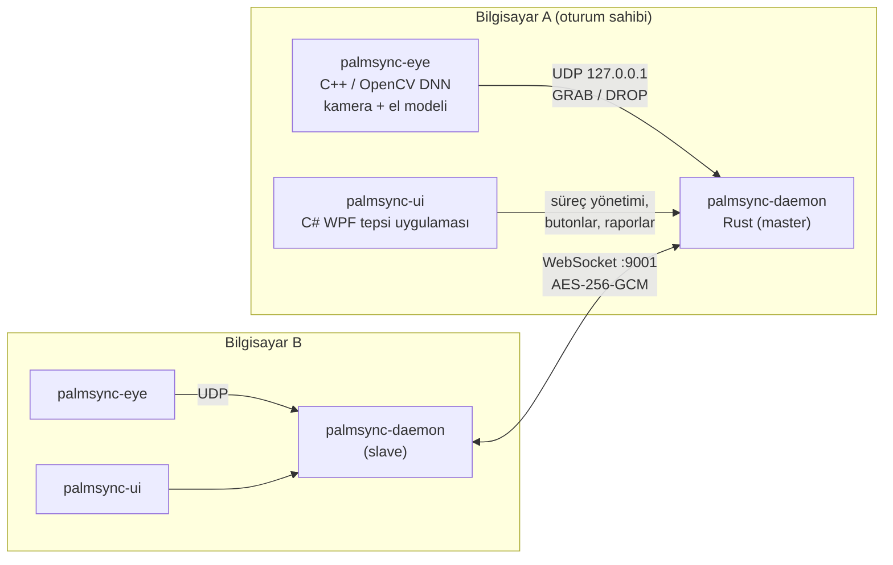

# 🖐 PalmSync

**El hareketiyle bilgisayarlar arasında iş aktarımı — bulutsuz, uçtan uca şifreli.**

[](https://github.com/SerdarK44/PalmSync-Gesture-Based-Context-Transfer-Between-Devices/releases/latest)


[](LICENSE)

Bir bilgisayarda kameraya açık elini gösterip **yumruk yaparsın**: o an önündeki
uygulama, açık belgesi, tarayıcı sayfası, ekran görüntüsü ve pano **yakalanır**.
Diğer bilgisayarda **yumruğunu açarsın**: hepsi orada kaldığın yerden açılır.
Sunucu yok, hesap yok. İki bilgisayar aynı ağda doğrudan ve şifreli konuşur.

---

## İçindekiler

- [Ne aktarılır, nasıl açılır?](#ne-aktarılır-nasıl-açılır)
- [Kurulum](#kurulum)
- [Kullanım](#kullanım)
- [Güvenlik ve gizlilik](#güvenlik-ve-gizlilik)
- [Mimari](#mimari)
- [Kaynaktan derleme](#kaynaktan-derleme)
- [Testler](#testler)
- [Belgeler](#belgeler)
- [Lisans](#lisans)

---

## Ne aktarılır, nasıl açılır?

**Yakala** anında öndeki pencereden şunlar alınır:

- **Uygulama:** hangi program olduğu
- **Belge:** program bir dosya gösteriyorsa, dosyanın kendisi (metin ≤ 2 MB, diğer dosyalar ≤ 8 MB)
- **Sayfa:** tarayıcıdaysa adres
- **Klasör:** Dosya Gezgini'ndeyse açık klasör
- **Ekran görüntüsü:** pencerenin görüntüsü
- **Pano:** kopyalanan metin

**Geri yükle** dendiğinde diğer bilgisayar elindeki en iyi seçeneği kullanır:

| Öndeki | O bilgisayarda aynı program varsa | Yoksa |
|---|---|---|
| 🌐 Tarayıcı (Chrome, Edge, Brave, Firefox, Opera, Vivaldi) | Sayfa aynı tarayıcıda açılır | Sayfa varsayılan tarayıcıda açılır (Chrome → Brave) |
| 📝 Düzenleyici (VS Code, Cursor, Sublime Text, Notepad++, Not Defteri…) | Dosya aynı düzenleyicide açılır | Sırayla: VS Code → Cursor → VSCodium → Sublime Text → Notepad++ → Not Defteri |
| 📄 Belge ya da başka bir uygulamada açık dosya (Word, Excel, PDF, resim, video, Typora…) | Dosya aynı programda açılır | **O dosya uzantısını destekleyen** bir programda açılır: önce varsayılan programı, o yoksa Windows'a o tür için kayıtlı başka bir program (Word → LibreOffice, Photoshop `.psd` → GIMP) |
| 🗂 Tarayıcıda açık yerel dosya (PDF, HTML, resim) | Aynı tarayıcıda açılır | Dosya olarak gider; uzantısını destekleyen programda açılır (PDF → Acrobat/Edge) |
| 📁 Dosya Gezgini | Aynı klasör açılır | Ekran görüntüsü gösterilir |
| 🎵 Belgesiz uygulama (Spotify, Discord, Figma…) | Uygulama başlatılır | Ekran görüntüsü + **"Uygulama bulunamadı"** uyarısı |

Hiçbir şey uymazsa dosya `Belgeler\PalmSync\Gelen Dosyalar` klasörüne
kaydedilir, Gezgin'de gösterilir ve ekran görüntüsü açılır. Her geri yüklemeden
sonra bir bildirim ne yapıldığını söyler. Örnek: *"Sublime Text bu bilgisayarda
yok — notlar.txt VS Code ile açıldı"*.

## Kurulum

1. [Releases](https://github.com/SerdarK44/PalmSync-Gesture-Based-Context-Transfer-Between-Devices/releases/latest)
   sayfasından **`PalmSync-Setup-x.y.z.exe`** dosyasını indirip çalıştır.
   Gerekirse .NET 8 Desktop Runtime'ı kendisi kurar; internet bağlantısı gerekmez.
2. İlk açılışta **Sistem kontrolü** penceresi gelir; **🔧 Hepsini düzelt** de.
3. Bunu iki bilgisayarda da yap. Bilgisayarların aynı Wi-Fi'de ya da aynı ağda olması yeterli.

> Kurulum dosyası kendinden imzalı bir sertifikayla imzalıdır. Windows
> SmartScreen uyarırsa *Ek bilgi → Yine de çalıştır*. Akıllı Uygulama Denetimi
> açık bilgisayarlar için bkz. [SETUP.md](SETUP.md) → "İmza / Smart App Control".

Yeni sürümler uygulamanın içinden gelir: ana pencerede **"⬆ Güncelleme var"**
çıkar. İndirilen kurulum dosyası SHA-256 ve imza ile doğrulanır.

## Kullanım

| Adım | Bilgisayar A | Bilgisayar B |
|---|---|---|
| 1 | **Oturum başlat** → bir kod ve şifre görünür | **Oturuma katıl** → kodu ve şifreyi gir |
| 2 | Aktarmak istediğin pencereyi öne al | |
| 3 | ✊ **Yakala**: butona bas ya da açık elini yumruk yap | |
| 4 | | 🖐 **Geri yükle**: butona bas ya da yumruğunu aç |

**El hareketleri (Kamera 2.0):** her karede elin 21 eklem noktası bulunur ve
açık el / yumruk parmak açılarından hesaplanır. Cilt rengine, yüze ve arka
plana bağlı değildir.

- Hareketleri kısa ve net yap.
- Bir hareketten sonra ~1,5 sn bekle.
- Elini yavaşça indirmek hareket sayılmaz.

Kamera olmadan da her şey butonlarla çalışır. Ayrıntılar ve sorun giderme için:
**[SETUP.md](SETUP.md)**.

## Güvenlik ve gizlilik

- **Şifreli bağlantı:** Bağlanma tekrar saldırısına dayanıklı bir
  challenge-response el sıkışmasıyla yapılır. Sonrasında tüm trafik
  **AES-256-GCM** ile uçtan uca şifrelidir. Hız sınırları ve kopan bağlantılar
  için heartbeat vardır.
- **Kod çalıştırılmaz:** Diğer bilgisayardan gelen bir program yolu asla
  çalıştırılmaz; program her makinede yerel olarak aranır. Kabuklar, betik
  yorumlayıcıları ve kurulum programları hiç başlatılmaz. `.bat`, `.ps1`, `.exe`
  gibi kod çalıştıran dosyalar yalnızca bir düzenleyicide metin olarak açılır.
  Hiçbir şey `cmd` üzerinden açılmaz.
- **Gelen dosyalar işaretlenir:** Dosyalar "başka bilgisayardan geldi"
  işaretini (Mark-of-the-Web) taşır; Office bunları Korumalı Görünüm'de açar.
- **Ekran görüntüsüne dikkat:** Ekran görüntüsü, pencerede o an ne görünüyorsa
  onu içerir. Parola yöneticileri, Windows kimlik pencereleri ve gizli gezinti
  pencerelerinin görüntüsü hiç alınmaz.

Ayrıntılı tehdit modeli: [SECURITY.md](SECURITY.md).

## Mimari



| Klasör | Dil | Görev |
|---|---|---|
| [`brain/`](brain) | Rust | Arka plan servisi: uygulama/belge/sayfa/ekran görüntüsü yakalama, uygulama eşleştirme ve geri yükleme, oturum, loglar |
| [`networking/`](networking) | Rust | Master/slave WebSocket katmanı, el sıkışma, şifreleme, hız sınırlama, heartbeat |
| [`shared/`](shared) | Rust | Mesajlar, yapılandırma, kripto, doğrulama, denetim kaydı |
| [`eye/`](eye) | C++17 / OpenCV | Kamera, MediaPipe el modelleri (PalmDet + HandPose), poz sınıflandırma, hareket durum makinesi, rehberli test modu |
| [`ui/`](ui) | C# / WPF (.NET 8) | Tepsi uygulaması, ana pencere, kamera önizlemesi, log görüntüleyici, sistem kontrolü, güncelleyici |
| [`installer/`](installer) | Inno Setup | Kurulum, imzalama, sertifika ve güvenlik duvarı ayarı |
| [`documents/`](documents) | — | Yol haritası ve faz belgeleri |

## Kaynaktan derleme

**Gereksinimler (Windows 10/11 x64):**

- Rust (stable)
- Visual Studio 2026 (C++ masaüstü iş yükü, CMake dahil)
- vcpkg ile OpenCV:
  `vcpkg install "opencv4[dnn,highgui,msmf,dshow,jpeg,png,tiff,webp]:x64-windows"`
- .NET 8 SDK
- Inno Setup 6 (yalnızca kurulum dosyası için)

```powershell
.\build.ps1                    # daemon + eye + ui  ->  build\
.\build.ps1 -Installer -Sign   # + imzalı dist\PalmSync-Setup-<sürüm>.exe
.\eye\build.ps1                # C++ derleme + kamera testleri (modelleri doğrulayarak indirir)
cargo test --workspace         # Rust testleri
```

Sürüm numarasının tek kaynağı kök dizindeki [`VERSION`](VERSION) dosyasıdır.
Daemon, kamera modülü, arayüz ve kurulum dosyası sürümü buradan okur. Yeni sürüm
yayınlamak için `.\release.ps1` (ya da `.\release.ps1 -Version 1.0.0`) çalıştır.
Betik derler, imzalar, etiketler ve GitHub Release'i oluşturur.

## Testler

160 otomatik test bulunuyor. Kapsadıkları:

- kripto ve tekrar saldırısı
- gerçek WebSocket üzerinde master/slave entegrasyonu
- güvenlik ve regresyon testleri
- uygulama eşleştirme ve güvenli geri yükleme kararları
- el hareketi durum makinesi
- gerçek kamera kayıtlarının yeniden oynatılması

Gerçek kamera doğrulaması için ekranda yönlendirmeli bir test yürütücüsü
(`eye\run-camera-tests.ps1`), uygulama aktarımı için de tanılama komutları
(`palmsync-daemon capture-test` / `restore-test`) var. Ayrıntılar:
[TESTING.md](TESTING.md).

## Belgeler

| Belge | İçerik |
|---|---|
| [SETUP.md](SETUP.md) | Kurulum, kullanım, el hareketleri, güncellemeler, loglar, sorun giderme |
| [TESTING.md](TESTING.md) | Test takımları, komutlar, tanılama araçları |
| [SECURITY.md](SECURITY.md) | Tehdit modeli ve güvenlik önlemleri |
| [KNOWN_ISSUES.md](KNOWN_ISSUES.md) | Bilinen sınırlamalar ve düzeltilen hatalar |
| [documents/](documents/README.md) | Yol haritası, faz belgeleri, kamera test günlüğü |

## Lisans

[Apache License 2.0](LICENSE). Kurulum paketindeki üçüncü taraf bileşenler
(OpenCV, MediaPipe kökenli el modelleri, Haar cascade dosyaları, Visual C++
çalışma zamanı) kendi lisanslarıyla dağıtılır; bkz.
[THIRD_PARTY_NOTICES.md](THIRD_PARTY_NOTICES.md) ve [NOTICE](NOTICE).
